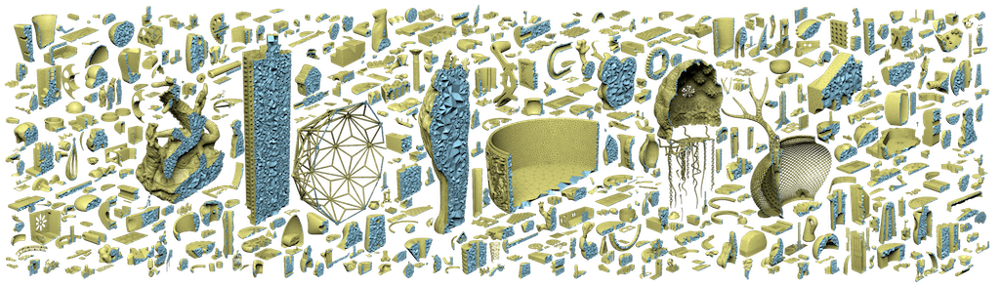
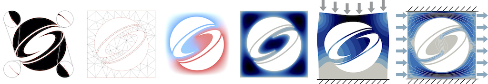

# Wildmeshing

_Robust 2d and 3d meshing package_

Check the [Wildmeshing Toolkit](https://wildmeshing.github.io/wildmeshing-toolkit/) for our open-source C++ robust toolkit, with its
Python package: tutorials, examples and the reference of every component.

Check [TetWild](tetwild.md) and [fTetwild](ftetwild.md) for our open-source C++ robust tet-mesher.

Check [TriWild](triwild.md) for our C++ curved tri-mesher.

If you just want to run it, checkout our [python bindings](python.md)! 
They provide a precompiled binary downloadable trough [conda forge](https://anaconda.org/conda-forge/wildmeshing) with an easy-to-use python interface.

## License

The code of Wildmeshing itself is licensed under [MIT License](https://github.com/wildmeshing/wildmeshing-toolkit/blob/main/LICENSE). However, please be mindful of third-party libraries which are used by Wildmeshing and may be available under a different license.
